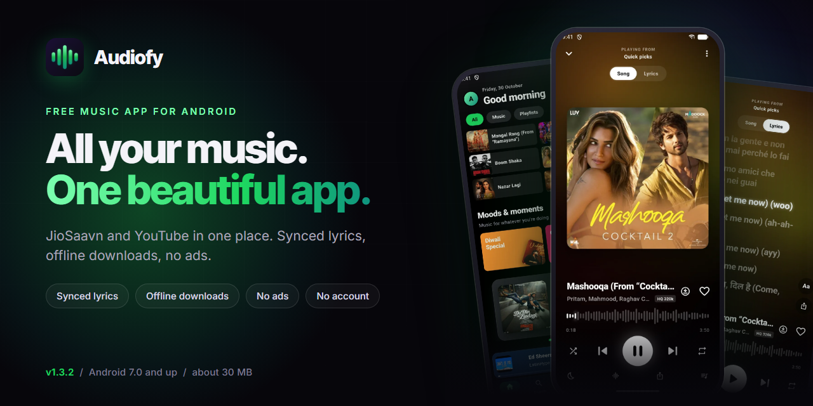
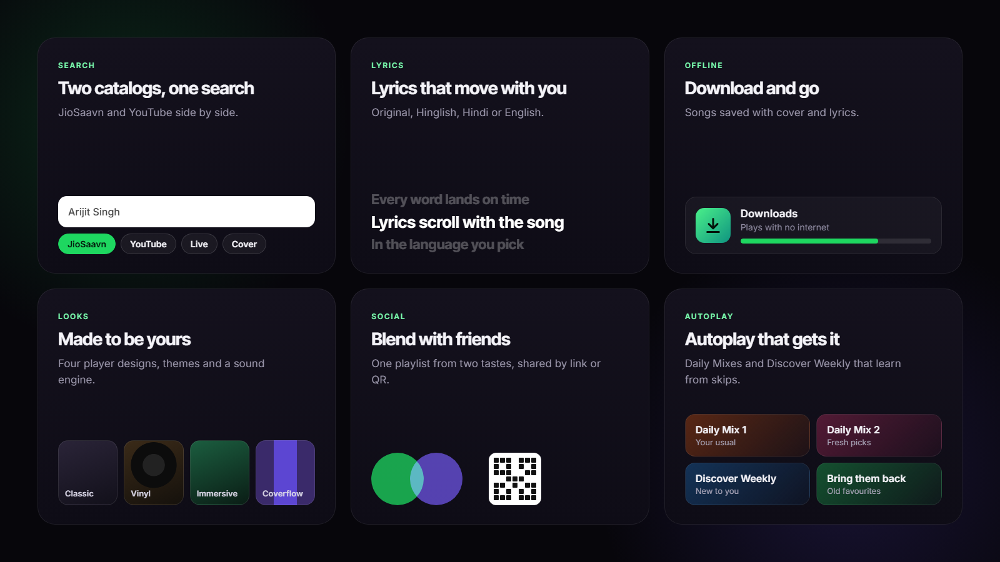
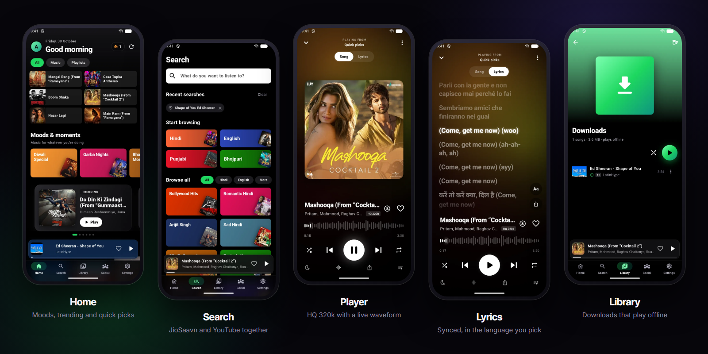
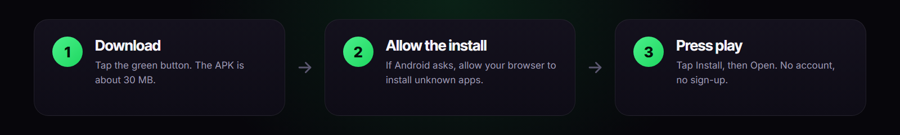

<h1>Audiofy: free music app for Android</h1>

<b>JioSaavn and YouTube in one search and one player</b>, with synced lyrics, offline downloads and no ads.

&nbsp;

&nbsp;

 

## What is Audiofy

**Audiofy is a free music app for Android.** It puts JioSaavn and YouTube side by side in one search, plays them in a single player, and adds time-synced lyrics, offline downloads and smart autoplay. There are no ads, no subscription and no sign-up. Your library stays on your phone.

This repository hosts the official APK downloads. The app itself checks here for new versions.

 

## Highlights

<b>Feature details</b>

 

- **Two catalogs, one search.** JioSaavn and YouTube together. Film songs, indie covers and live versions in one place.
- **Lyrics that move with you.** Time-synced, in the original, Hinglish, Hindi or English. Share a line as a card.
- **Download and go.** Save songs in high quality with cover and lyrics. Play them with no internet.
- **Made to be yours.** Four player designs (Classic, Vinyl, Immersive, Coverflow), themes, and a sound engine with equalizer, reverb and more.
- **Blend with friends.** Mix two tastes into one playlist with a link or a QR code. Play Antakshari or the music quiz.
- **Autoplay that gets it.** Daily Mixes, Discover Weekly and a radio that learns from what you skip.

 

## Best for

- Listening to Hindi, Punjabi, Bhojpuri and English songs in one app
- Reading synced lyrics while you listen
- Saving songs to listen offline
- Sharing a playlist with a friend
- Using one free app instead of switching between several

Not sure if Audiofy fits? Read [how Audiofy compares](COMPARE.md), including who should pick something else.

 

## A closer look

 

## Install

1. **Download** the APK with the green button at the top.
2. **Open** the file. If Android asks, allow your browser to install unknown apps.
3. **Tap Install**, then Open. Just press play.

| File | For | Size |
|---|---|---|
| [`audiofy-arm64-v8a.apk`](https://github.com/Crylord-zx/audiofy-releases/releases/latest/download/audiofy-arm64-v8a.apk) | Nearly every phone from the last several years | about 30 MB |
| [`audiofy-armeabi-v7a.apk`](https://github.com/Crylord-zx/audiofy-releases/releases/latest/download/audiofy-armeabi-v7a.apk) | Older 32-bit phones | about 28 MB |

Audiofy tells you when a new version is out. Tap **Update now**, then tap the **Download complete** notification to install it over the old one. Your library and downloads stay put.

 

## Questions

<b>Is Audiofy free?</b>

 
Yes. Audiofy is free, with no ads and no subscription.

<b>Why does Android warn me before installing?</b>

 
Android shows an unknown app prompt for every app that does not come from the Play Store. Audiofy is published only here and on its website, so the prompt is expected. If Play Protect offers to scan the app, tap <b>Scan app</b>. If it shows <b>More details</b>, you can choose <b>Install anyway</b>. Each release page lists the SHA-256 of every file so you can check your download.

<b>Which phones does it work on?</b>

 
Android 7.0 or newer. Use the main download on most phones, and the 32-bit file only on older ones.

<b>Do I need an account?</b>

 
No. Your library, likes and downloads stay on your phone.

<b>Is there an iPhone version?</b>

 
Not yet. Audiofy is Android only for now.

<b>How is Audiofy different from other free music apps?</b>

 
It searches JioSaavn and YouTube together, shows synced lyrics in the language you pick, saves songs with their cover and lyrics for offline play, and lets two people blend their taste into one playlist. See the full <a href="COMPARE.md">comparison</a>.

More answers are in the [FAQ](FAQ.md).

 

## Glossary

| Term | Meaning |
|---|---|
| **APK** | The file format Android uses to install an app. Audiofy is installed from an APK, not from the Play Store. |
| **arm64-v8a** | The 64-bit build for nearly every phone from the last several years. |
| **armeabi-v7a** | The 32-bit build for older phones. |
| **Synced lyrics** | Lyrics that scroll in time with the song, line by line. |
| **Blend** | A shared playlist that mixes your taste with a friend's, shared by link or QR code. |
| **Daily Mix** | A playlist Audiofy builds from what you play, with songs in the same language and mood. |
| **Play Protect** | Google's on-device app scanner. It may ask to scan apps that do not come from the Play Store. |
| **SHA-256** | A fingerprint of a file. Each release page lists one for every APK, so you can check your download. |

 

## Facts

| | |
|---|---|
| **App** | Audiofy, a music streaming and download app for Android |
| **Latest version** | 1.3.2 ([all releases](https://github.com/Crylord-zx/audiofy-releases/releases)) |
| **Package** | `com.audiofy.app.audiofy` |
| **Requires** | Android 7.0 or newer |
| **Price** | Free, no ads, no in-app purchases |
| **Account** | Not needed |
| **Website** | [audiofy-music.vercel.app](https://audiofy-music.vercel.app) |
| **More** | [FAQ](FAQ.md) / [Comparison](COMPARE.md) / [Changelog](CHANGELOG.md) |

 

Audiofy is an independent app and is not affiliated with or endorsed by JioSaavn or YouTube. All trademarks belong to their owners.

